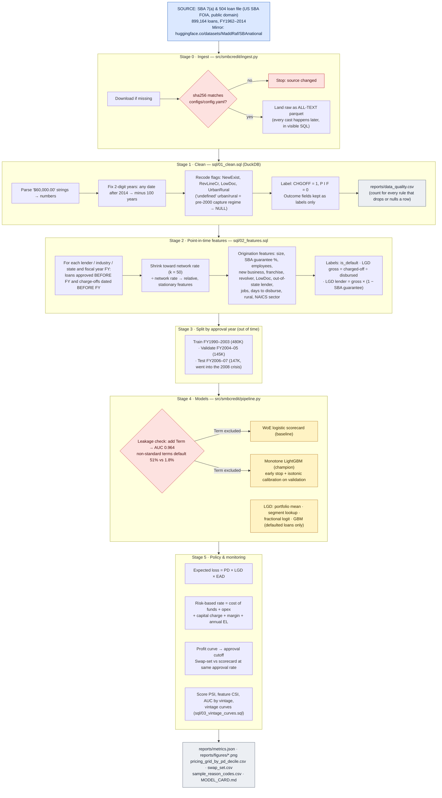
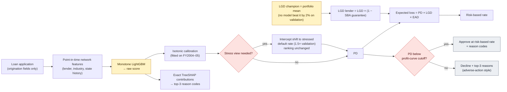
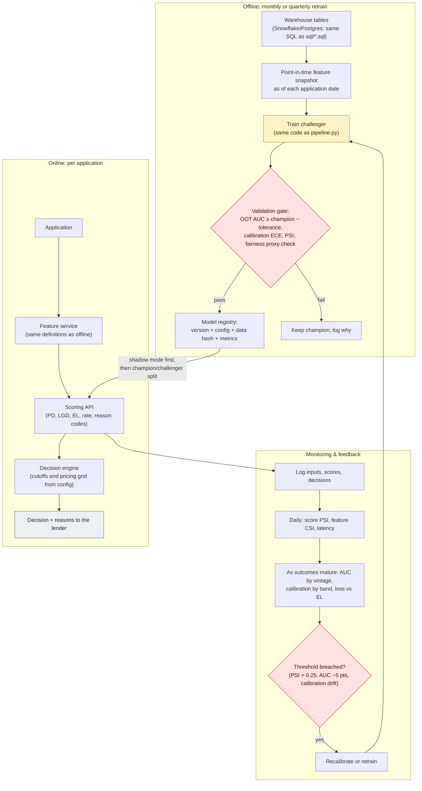

# How this project works

Three diagrams:
1. **Pipeline**: every step, its source file, and the logic inside it.
2. **Model and decision logic**: how a loan goes from features to a PD, an LGD, expected loss, a price and an approve/decline.
3. **Production design**: how the same code would run as a live service. This is a proposed design and is not implemented in this repo.

Colour key: **blue** = external data source · **lavender** = code step (file named in the box) · **yellow** = model · **red** = check or gate · **grey** = output

## 1. Pipeline (what `make all` runs)

## 2. Model and decision logic for one loan

Monotone constraints: PD rises with lender, industry and state relative charge-off rates and falls with employee count. Every other feature is unconstrained.

## 3. Production design (proposed; not implemented in this repo)

## How to run

| Step | Command | Time |
|---|---|---|
| Install | `pip install -r requirements.txt` | ~1 min |
| Everything | `make all` (or `PYTHONPATH=src python -m smbcredit.pipeline`) | ~3 min |
| Tests | `make test` | seconds |
| Change splits / pricing | edit `configs/config.yaml`, rerun | — |
